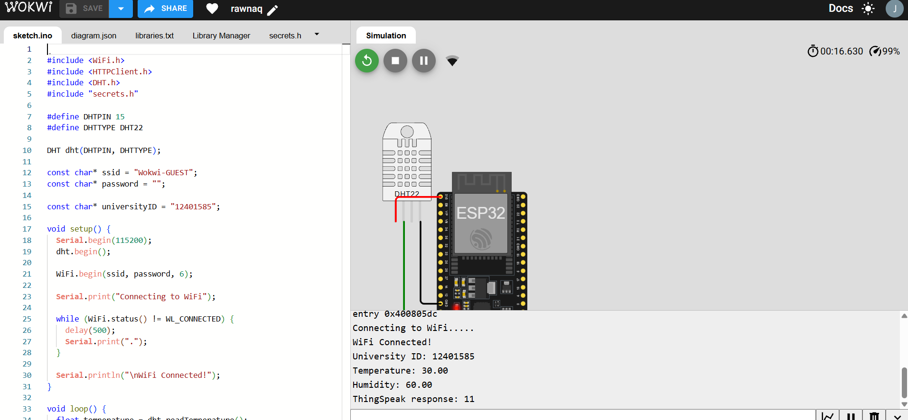
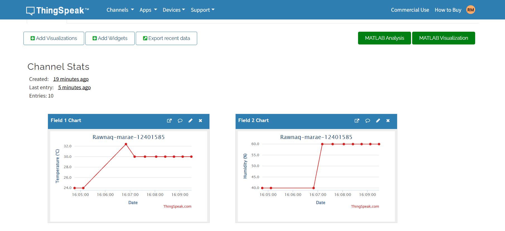

# ESP32 DHT22 Temperature and Humidity Monitoring

## Student Information
- **Name:** Rawnaq Marae
- **University ID:** 12401585

## Project Description
This project uses an ESP32 microcontroller and a DHT22 sensor to monitor temperature and humidity.

The project is simulated using Wokwi. The ESP32 connects to Wi-Fi, reads temperature and humidity values from the DHT22 sensor, and sends the readings to ThingSpeak using HTTP requests every 20 seconds.

ThingSpeak displays the collected data in two real-time charts.

## Components
- ESP32 Development Board
- DHT22 Temperature and Humidity Sensor
- Wokwi Simulator
- ThingSpeak IoT Platform

## Wiring Connections

| DHT22 Pin | ESP32 Pin |
|---|---|
| VCC | 3.3V |
| DATA | GPIO 15 |
| GND | GND |

## Wokwi Simulation
https://wokwi.com/projects/478860324247301121

## ThingSpeak Channel
- **Channel Name:** Rawnaq-marae-12401585
- **Channel ID:** 3549803
- **Public URL:** https://thingspeak.com/channels/3549803

## Setup Instructions

To run this project, create a file named `secrets.h` in the project folder and add the following line:

`#define THINGSPEAK_API_KEY "YOUR_WRITE_API_KEY"`

Replace `YOUR_WRITE_API_KEY` with the Write API Key from your ThingSpeak channel.

Do not upload your real API key to GitHub.

## Results
The ESP32 successfully connects to Wi-Fi and sends temperature and humidity readings to ThingSpeak every 20 seconds.

The collected readings are displayed in two charts:
- **Field 1:** Temperature (°C)
- **Field 2:** Humidity (%)

The simulation and ThingSpeak charts demonstrate successful cloud-based temperature and humidity monitoring.

## Screenshots

The following screenshots show the Wokwi circuit and the ThingSpeak temperature and humidity charts.

## Conclusion
The ESP32 and DHT22 sensor were successfully integrated with ThingSpeak using the Wokwi simulator. The project demonstrates real-time IoT monitoring of temperature and humidity through Wi-Fi and cloud-based visualization.
